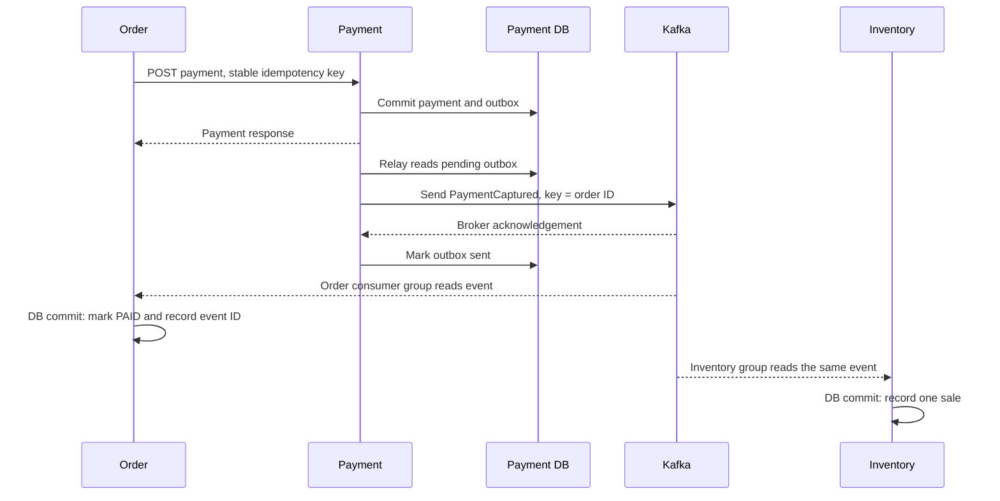

# Kafka edition: what changed and why

This ZIP replaces the RabbitMQ transport with **Apache Kafka**. Kafka is a separate event-streaming broker, not a RabbitMQ configuration mode. This project does not run a bridge between the two brokers. The synchronous REST flow still supplies product lookup and payment creation; Kafka supplies the asynchronous payment notification.

## Start and test

```bash
docker compose up --build -d
python3 scripts/scenarios.py --traces
# Optional broker outage/recovery:
python3 scripts/scenarios.py --traces --disrupt
# Bad-event recovery:
python3 scripts/poison_event.py
python3 scripts/poison_event.py --malformed
```

Read README.md first if the earlier RabbitMQ stack is running. This edition uses a different Compose project name and fresh volumes. It does not move already-published RabbitMQ messages into Kafka. For an existing real system, migration would require a planned cutover/replay strategy; starting both relays against the same outbox is not such a strategy.

## The communication flow



The scheduler's publish and the HTTP response can race; the HTTP path does not wait for either consumer. Database commit and Kafka offset commit are separate operations, so duplicate handling remains necessary.

## Map familiar RabbitMQ concepts to this implementation

| Earlier RabbitMQ edition | Kafka edition | Why it matters |
|---|---|---|
| Direct exchange plus two queues | One `payment.captured.v1` topic plus two groups | Both services independently read the event |
| Queue consumers share work | Members of one group share topic partitions | Scale replicas of one service with the same group ID |
| Queue retains unacknowledged messages | Topic retains records; groups track offsets | Reading a record does not delete it |
| Routing key selects queue bindings | Record key selects a partition | Order ID groups one order's records within a partition |
| Publisher confirm | `KafkaTemplate.send(...).get(...)` with `acks=all` | Mark outbox sent only after broker acknowledgement |
| Listener acknowledgement | RECORD offset commit after successful listener return | Commit the local DB before recording consumption progress |
| Per-queue DLQ | Per-group dead-letter topic (DLT) | An Order failure is distinguishable from an Inventory failure |

There are three partitions in each topic. This is still **one broker** with replication factor one; partitions provide parallelism, not redundant brokers. KRaft supplies Kafka's metadata/controller mode, so no ZooKeeper container is needed.

## Publisher: what each statement does

Source: [OutboxRelay.java](payment-service/src/main/java/dev/pratik/lab/payment/OutboxRelay.java).

```java
ProducerRecord<String, String> record = new ProducerRecord<>(
    KafkaConfiguration.PAYMENTS, event.orderId().toString(), row.getPayload());
record.headers().add(CorrelationFilter.HEADER,
    row.getCorrelationId().getBytes(StandardCharsets.UTF_8));
kafka.send(record).get(12, TimeUnit.SECONDS);
```

| Statement | What / why / how |
|---|---|
| `ProducerRecord<String, String>` | A topic record with a String key and JSON String value. No Java entity crosses the broker. |
| `KafkaConfiguration.PAYMENTS` | The versioned event topic, created by KafkaAdmin at startup. |
| `event.orderId().toString()` | The key; the producer consistently chooses a partition for that order while partition count is stable. |
| `row.getPayload()` | Use the committed outbox JSON; do not invent a new event ID on retry. |
| `headers().add(...)` | Preserve the correlation ID for diagnosis. Kafka observation also supplies tracing headers. |
| `kafka.send(...)` | Send using the configured serializers, broker addresses and producer acknowledgement policy. |
| `.get(12, SECONDS)` | Await this send's result before the following HQL update marks the outbox row sent. Failure keeps the row pending. |

The surrounding method restores the saved W3C parent context and starts an `outbox.publish` span. `spring.kafka.template.observation-enabled=true` enables the producer observation; listener observation continues the trace during consumption. Trace continuity through Zipkin is checked by scenario S16 against the running stack.

Kafka producer idempotence does not eliminate a new send after a scheduler crash, restart or explicit replay. Keep `ProcessedEvent`/`SalesReceipt` deduplication. All entity access and mutations still use explicit HQL.

## Consumer: what each statement does

Source: [OrderPaymentListener.java](order-service/src/main/java/dev/pratik/lab/order/OrderPaymentListener.java). Inventory uses the same pattern in [PaymentEventListener.java](inventory-service/src/main/java/dev/pratik/lab/inventory/PaymentEventListener.java).

```java
@KafkaListener(topics = KafkaConfiguration.PAYMENTS,
               groupId = KafkaConfiguration.ORDERS_GROUP)
public void receive(String payload) {
    PaymentCaptured event = codec.decode(payload);
    try (var ignored = MDC.putCloseable("correlationId", event.correlationId())) {
        store.markPaid(event);
    }
}
```

| Statement | What / why / how |
|---|---|
| `@KafkaListener` | Spring creates and manages a consumer container that polls Kafka. |
| `topics` | The event stream to read. |
| `groupId` | Independent progress for this service. Order uses `order-service`; Inventory uses `inventory-service`. |
| `String payload` | Keep raw JSON until the listener runs, so malformed JSON can also be recovered into a DLT. |
| `codec.decode` | Jackson JSON parsing, supported schema check and field validation. Bad input becomes a nonretryable exception. |
| `MDC.putCloseable` | Include correlation ID in logs and clean the thread-local entry after handling. |
| `store.markPaid` | A separate Spring transaction inserts the event ID and updates the order using HQL. Repeated event IDs have no extra effect. |
| Successful return | In RECORD mode, Spring commits that group's offset after the DB transaction has returned successfully. |

The main topic is retained for seven days. A stopped service resumes from committed offsets if records are still retained. Never give Order and Inventory the same group ID: that would divide messages between their instances instead of letting both services process each event.

## Error handling

Source: [KafkaConfiguration.java](lab-common/src/main/java/dev/pratik/lab/common/KafkaConfiguration.java).

- `DefaultErrorHandler` manages failed record delivery.
- `ExponentialBackOffWithMaxRetries(2)` allows two retries after the original attempt: 200 ms and 400 ms delays.
- `IllegalArgumentException` is nonretryable here because it represents invalid JSON, schema or payment/order mismatch.
- `DeadLetterPublishingRecoverer` sends exhausted/invalid records to the affected group's DLT.
- `setFailIfSendResultIsError(true)` prevents treating a failed DLT publish as successful recovery.
- After successful recovery, the failed source record can be passed and later records processed. The original payload/key and diagnostic headers remain available in the DLT.

DLTs are `payment.captured.v1.order-service.DLT` and `payment.captured.v1.inventory-service.DLT`. There is no automatic DLT replay loop. Repair the cause and plan a deliberate replay; DLT records can themselves be duplicated after an ambiguous result/crash.

## Configuration locations and addresses

| File | Purpose |
|---|---|
| [lab-common/pom.xml](lab-common/pom.xml) | `spring-kafka` runtime dependency; `spring-kafka-test` test dependency |
| [compose.yml](compose.yml) | Apache Kafka 4.1.2 KRaft broker, storage and health check |
| [order application.yml](order-service/src/main/resources/application.yml) | Producer/consumer settings; same Kafka settings exist in Payment/Inventory |
| [KafkaConfiguration.java](lab-common/src/main/java/dev/pratik/lab/common/KafkaConfiguration.java) | Topic names, groups, partitions, retry and DLT policy |
| [k8s/lab.yml](k8s/lab.yml) | Optional local-cluster Kafka deployment/PVC/service |
| [test.md](test.md) | Startup, poison, backlog, outage and tracing scenarios |

Docker applications and broker CLI use `kafka:29092`; host/IDE clients use `localhost:9092`. Override `KAFKA_BOOTSTRAP_SERVERS` for the applications. Kafka returns its **advertised addresses** after the bootstrap connection, so changing only the bootstrap address is not enough when deploying to another machine. Update the broker advertised listener too.

## Security and saga boundary

The local Kafka listener is **PLAINTEXT without SASL or ACLs**. This was selected for a minimal local exercise. Its host port is published on loopback, but container traffic is not encrypted. The OAuth/JWT configuration protects REST endpoints; it does not protect access to Kafka. A deployed Kafka environment needs TLS with certificate/hostname validation, suitable client authentication (for example SASL/SCRAM over TLS or client certificates), and per-service topic/group permissions. HTTP and PostgreSQL transport encryption are also not yet configured.

**A saga has not been implemented.** The application demonstrates event delivery and local database transactions. It does not implement inventory reservation, refunds, persistent saga state, compensation commands, or compensation failure recovery. A DLT is not a compensation operation. A future saga would coordinate forward steps and business compensation across those local transactions; choosing Kafka does not add that behavior automatically.

## Verification and references

See [VERIFICATION.md](VERIFICATION.md) for exact executed checks and limitations. `KafkaDeliveryTest` uses a real in-process Kafka 3.9.2 KRaft broker from Spring Boot's managed test dependencies. Compose pins broker 4.1.2; its full-stack scenarios need Docker and are reported separately.

- [Spring Kafka 3.3 error handling](https://docs.spring.io/spring-kafka/reference/3.3/kafka/annotation-error-handling.html)
- [Spring Kafka observations](https://docs.spring.io/spring-kafka/reference/3.3/kafka/micrometer.html)
- [Kafka listener offset commit modes](https://docs.spring.io/spring-kafka/reference/3.3/kafka/receiving-messages/message-listener-container.html)
- [Spring Kafka embedded test broker](https://docs.spring.io/spring-kafka/reference/3.3/testing.html)
- [Apache Kafka producer configuration](https://kafka.apache.org/41/configuration/producer-configs/)
- [Apache Kafka Docker image](https://kafka.apache.org/41/getting-started/docker/)
