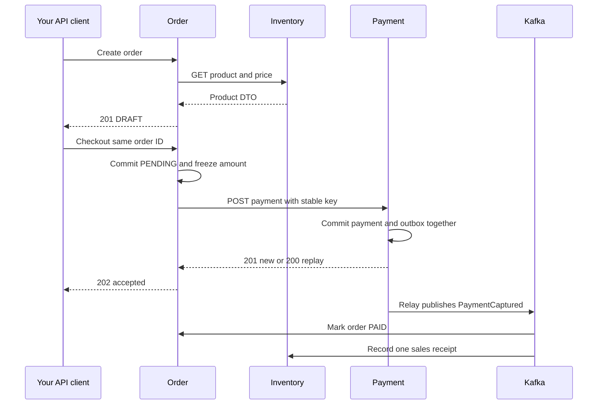
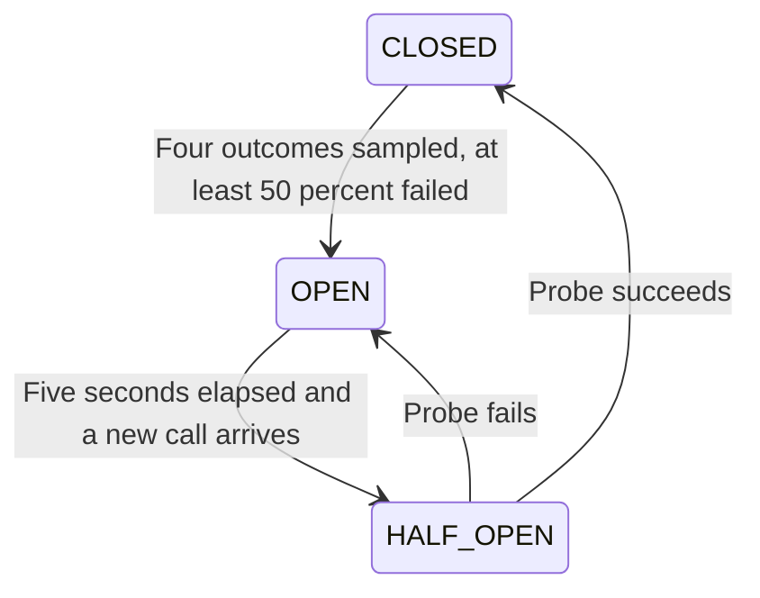

# Learn service communication through one small system

Pratik, start with the first flow below. Read a linked method, run its scenario, and change one setting at a time. The source uses constructor injection and ordinary Java classes/records so there is little framework magic to decode.

## 0. The flow and the boundaries



The relay is a scheduled component inside Payment, not a separate application. The broker can be unavailable during payment creation: the outbox preserves the event for later. Order and Inventory use separate **consumer groups** on one Kafka topic, so **both** read every event. Instances in the same group share partitions. Kafka retains records after consumption; each group tracks its own offsets.

Order does not hold a database transaction while making the Payment HTTP call. `OrderStore.beginCheckout()` commits first; the controller then calls `PaymentClient.charge()`. The business state is intentionally observable: `DRAFT` → `PENDING` → `PAID`.

Code: [OrderController](order-service/src/main/java/dev/pratik/lab/order/OrderController.java), [PaymentStore](payment-service/src/main/java/dev/pratik/lab/payment/PaymentStore.java), [OutboxRelay](payment-service/src/main/java/dev/pratik/lab/payment/OutboxRelay.java), [KafkaConfiguration](lab-common/src/main/java/dev/pratik/lab/common/KafkaConfiguration.java).

## 1. Basic HTTP communication

**What:** one process sends a request; another sends a response. Both contain metadata. A request may contain JSON; a response may contain JSON or no body.

**Why:** Order needs a price owned by Inventory and a payment operation owned by Payment. Reading their database tables directly would couple the services to private schemas.

**How:** controllers expose URLs; HTTP client classes call those URLs.

| Method | Executable example | Meaning here |
|---|---|---|
| POST | `/api/v1/orders` | Create a new draft; returns 201 and `Location` |
| GET | `/api/v1/orders/{id}` | Read one order; no business mutation |
| GET | `/api/v1/orders?status=DRAFT&page=0&size=10&sort=amount` | Filter, paginate and sort |
| PUT | `/api/v1/orders/{id}` | Replace the editable draft representation: SKU, quantity, note |
| PATCH | `/api/v1/orders/{id}` with `{"note":"changed"}` | Change just the note |
| DELETE | `/api/v1/orders/{id}` | Delete a draft; returns 204 with no body |
| POST | `/api/v1/orders/{id}/checkout` | Start/retry the checkout action |

The **URL** includes scheme, host, optional port, path and optional query. `{id}` is a **path variable** identifying a resource. `page` and `status` are **query parameters** changing a collection query. JSON is a **request body**. Headers describe identity, body format and context.

`PUT` here replaces all client-editable fields; server-owned ID, state and timestamps remain server-owned. `PATCH` uses a small custom DTO, not RFC JSON Patch. HTTP method semantics matter: GET is safe; PUT/DELETE are intended to be idempotent in effect; a repeated DELETE may return 404 after the first returned 204 while the final resource state remains absent. POST is not automatically idempotent.

Read [OrderController](order-service/src/main/java/dev/pratik/lab/order/OrderController.java): `@PathVariable`, `@RequestParam`, `@RequestBody`, `@Valid`, `ResponseEntity`. Run S03–S04 in [test.md](test.md).

## 2. Consumer and provider

**Provider:** exposes a particular API. **Consumer:** calls it. These are roles for an interaction, not permanent labels for a whole application.

| Interaction | Consumer | Provider |
|---|---|---|
| Your terminal calls Order | Your terminal | Order |
| Order looks up a price | Order | Inventory |
| Order creates a payment | Order | Payment |
| Order obtains a machine token | Order | Auth |

In events, the vocabulary changes to **producer/publisher** and **consumer/subscriber**. Payment produces a `PaymentCaptured` event; Order and Inventory consume it. An HTTP consumer normally receives the provider's response—it is not the component that originally sends that response.

Code: [InventoryClient.product](order-service/src/main/java/dev/pratik/lab/order/InventoryClient.java), [PaymentController.charge](payment-service/src/main/java/dev/pratik/lab/payment/PaymentController.java).

## 3. RestClient, WebClient, Feign and RestTemplate

| Client | Shape | Working example |
|---|---|---|
| RestClient | Fluent, blocking | `InventoryClient.product()` and `/api/lab/clients/restclient` |
| WebClient | Reactive API returning Mono/Flux | `PaymentClient.charge()` and `/api/lab/clients/webclient` |
| OpenFeign | Annotated interface with generated implementation | `PaymentFeignClient.instance()` and `/api/lab/clients/feign` |
| RestTemplate | Older imperative API | `/api/lab/clients/resttemplate` |

This project uses **Spring MVC** for its inbound HTTP controllers. Calling `block()` on WebClient is an intentional teaching bridge in that imperative flow; it occupies the servlet request thread while waiting. It does not make the entire application reactive. In a WebFlux application, return a `Mono` through the controller chain instead of blocking the event loop. Calling `subscribe()` yourself does not automatically give a reliable HTTP response or preserve your database transaction.

[ClientConfiguration](order-service/src/main/java/dev/pratik/lab/order/ClientConfiguration.java) injects Boot's client builders. Constructing clients casually with `WebClient.create()` or `new RestTemplate()` can omit Boot's observation customizations. The OAuth token client is separately bounded with its own request factory.

[ClientLabController](order-service/src/main/java/dev/pratik/lab/order/ClientLabController.java) gives four calls to the **same** Payment instance endpoint so you can compare syntax. These comparison calls deliberately have no business retry/circuit wrapper. Only the main `PaymentClient` has the demonstrated resilience policy.

### Read the main WebClient method one operation at a time

Open [PaymentClient.call](order-service/src/main/java/dev/pratik/lab/order/PaymentClient.java).

| Code operation | What it does and why |
|---|---|
| `client.post()` | Selects the HTTP operation that creates a payment |
| `.uri(...)` | Appends the provider route to the configured base URL |
| `.contentType(APPLICATION_JSON)` | Declares the format of the outgoing request body |
| `.accept(APPLICATION_JSON)` | Requests JSON in the response |
| `.headers(...)` | Adds the service token, stable idempotency key and correlation ID |
| `.bodyValue(request)` | Uses Jackson to turn the consumer's request DTO into JSON |
| `.retrieve()` | Configures response extraction; execution happens on subscription |
| `.onStatus(...)` | Releases an error response body and creates a typed downstream exception |
| `.bodyToMono(PaymentResponse.class)` | Deserializes successful JSON into the consumer's own DTO |
| `.timeout(...)` | Bounds the whole attempt in the reactive pipeline |
| `.onErrorMap(...)` | Converts transport/timeout failures into the resilience classification |
| `.contextCapture()` | Carries observation context into the reactive operation |
| `.block()` | Subscribes and obtains the response for this MVC caller |

Transport and timeout failures are retryable; malformed or empty successful responses are treated as contract failures and are not retried. A provider returning HTTP 200 without the promised response is still a failed integration.

## 4. Request DTOs, response DTOs and JSON

**DTO = Data Transfer Object.** Its job is to describe the public message, not the database row.

- Serialization: Java `ChargeRequest` → JSON bytes.
- Deserialization: JSON bytes → Java `ChargeRequest` on Payment, or `PaymentResponse` back on Order.
- `@Valid` and constraint annotations reject invalid input before persistence.

The Order request contains SKU/quantity/note. The stored order additionally has amount, currency, status, payment ID and creation time. Returning a JPA entity directly could expose private columns, lazy-loading behavior and internal relationships.

Consumer and provider intentionally have **separate** request/response record types in [OrderDtos](order-service/src/main/java/dev/pratik/lab/order/OrderDtos.java) and [PaymentDtos](payment-service/src/main/java/dev/pratik/lab/payment/PaymentDtos.java). Neither imports the other's database entity. A single versioned event record in the common module keeps this monorepo small; independently deployed teams should publish/evolve their event schemas with consumer compatibility checks rather than require all consumers to upgrade a shared library together.

Read [PurchaseOrder](order-service/src/main/java/dev/pratik/lab/order/PurchaseOrder.java) alongside those DTOs. A database entity and an HTTP DTO are different contracts.

## 5. Headers

| Header | Purpose | Implementation |
|---|---|---|
| `Authorization: Bearer <JWT>` | Proves the caller's identity and grants scopes | `SecurityConfig`, `ServiceTokens`, HTTP clients |
| `Content-Type: application/json` | Format actually sent | Controllers and `.contentType()` |
| `Accept: application/json` | Desired response format | `.accept()` and scenario runner |
| `Idempotency-Key` | Identifies one logical payment request across retries | `PaymentClient`, `PaymentStore` |
| `X-Correlation-ID` | Human-friendly identifier across logs/messages | `CorrelationFilter` and event payload |
| `traceparent` | Standard W3C trace ID, parent span ID and flags | Instrumented HTTP/Kafka clients and outbox context |
| `X-Trace-ID` | Convenience response header for opening this request's trace | `CorrelationFilter` |
| `X-Instance-ID` | Helps observe which Payment instance answered | `PaymentController` |
| `Retry-After` | Suggests how long the caller should wait | 429 lab response and downstream advice |

Correlation IDs and trace IDs are **not authentication credentials**. A trace contains multiple spans; the correlation ID is simply a search key. The filter permits a bounded set of characters so arbitrary incoming values cannot insert lines into logs. Trace IDs are generated/propagated by the tracing library; we do not overwrite them with the correlation ID.

Code: [CorrelationFilter](lab-common/src/main/java/dev/pratik/lab/common/CorrelationFilter.java), [DownstreamAdvice](order-service/src/main/java/dev/pratik/lab/order/DownstreamAdvice.java). Test S05/S16.

## 6. Authentication, authorization, JWT and OAuth 2.0

**Authentication:** who called? **Authorization:** is that identity allowed to do this operation?

**JWT** is a token format. **OAuth 2.0** defines authorization flows; it is not synonymous with JWT. This lab's authorization server issues signed JWT access tokens using the **client-credentials grant**, suitable for machine-to-machine calls. It does not implement a browser login flow or pretend that a machine token represents a human user.

1. `lab-client` requests a token from `/oauth2/token` with HTTP Basic client authentication and `grant_type=client_credentials`.
2. You send that access token as a bearer token to Order.
3. Order validates the signature using public keys from `/oauth2/jwks`, plus expiration/not-before, issuer and audience.
4. `@PreAuthorize` checks scopes such as `orders.write`.
5. Order gets its **own service token** to call Payment/Inventory. `ServiceTokens` uses Spring Security's authorized-client manager, which reuses a valid token and obtains a replacement when needed.

| Client | Available scopes |
|---|---|
| `lab-client` | Order read/write, Payment read/write, Inventory read, lab administration |
| `viewer` | Order read, Payment read, Inventory read |
| `order-service` | Payment read/write, Inventory read |

`SecurityConfig` expects issuer `http://localhost:9000` and audience `communication-lab`. Inside Docker, the issuer remains that logical identifier while keys are fetched from `http://auth-service:9000/oauth2/jwks`. An issuer comparison is not the same thing as a network call to that issuer on every request.

**Token forwarding** is demonstrated separately in `/api/lab/forward-token`: Order forwards the incoming bearer token to Payment. This is only valid when Payment trusts that issuer, accepts the token audience, and the token has its required scope. Blindly forwarding a token to arbitrary services is incorrect. The shared audience is a lab simplification; production designs usually use service-specific audiences/token exchange as appropriate.

Code: [AuthorizationConfig](auth-service/src/main/java/dev/pratik/lab/auth/AuthorizationConfig.java), [SecurityConfig](lab-common/src/main/java/dev/pratik/lab/common/SecurityConfig.java), [ServiceTokens](order-service/src/main/java/dev/pratik/lab/order/ServiceTokens.java). Test S01–S02, S05 and `AuthorizationServerTest`.

This API disables CSRF because it uses explicitly supplied bearer tokens without cookie/session login. Do not copy that decision into a browser application that relies on authentication cookies. Local HTTP, in-memory client registrations, public demo secrets and ephemeral signing keys keep the exercise short; production requires TLS, durable/rotated keys and managed secrets. Kafka also uses PLAINTEXT listeners in this local lab, with no SASL authentication or ACLs. JWT validation protects REST access; it does not authenticate Kafka clients. Use TLS plus suitable Kafka client authentication and per-service topic/group ACLs before exposing a real deployment. See KAFKA.md.

## 7. Timeouts

**What:** limits on how long each phase may wait. **Why:** one stalled dependency must not occupy every Order request thread forever.

| Limit | Setting in this lab |
|---|---|
| TCP connect timeout | Payment/Inventory clients: 500 ms |
| Pool acquisition timeout | Payment WebClient: 500 ms, with bounded connection/waiter counts |
| Response/read timeout | Payment/Inventory clients: 800 ms |
| Total reactive attempt | Payment WebClient: 2 seconds |
| Token endpoint connect/read | 1 second / 2 seconds |
| Database pool acquisition | 2 seconds |
| Kafka send | Metadata/buffer wait up to 3 seconds; delivery timeout 10 seconds; relay future wait 12 seconds |

A read timeout is not necessarily an end-to-end deadline; its exact behavior depends on the HTTP client. The separate Reactor `timeout` bounds the Payment attempt, including its asynchronous pipeline. With three attempts, total checkout time can exceed one attempt's timeout because attempts and backoff add together. This lab does not implement an end-to-end cross-service deadline propagation protocol.

**Crucial:** caller timeout does not undo the provider's committed database transaction. The `after-commit` fault deliberately demonstrates that ambiguity. Recover with the same order ID/idempotency key.

Code: [ClientConfiguration](order-service/src/main/java/dev/pratik/lab/order/ClientConfiguration.java), [PaymentClient](order-service/src/main/java/dev/pratik/lab/order/PaymentClient.java), [FaultInjector](payment-service/src/main/java/dev/pratik/lab/payment/FaultInjector.java). Test S12–S13.

## 8. Retry and backoff

**What:** repeat an operation after a selected transient failure. **Why:** a short network failure or temporary 503 may disappear on the next attempt.

The main payment policy retries transport/timeout errors and HTTP **502, 503, 504**, up to **three total attempts**. Backoff starts near 100 ms, grows exponentially with multiplier 2, and includes 25% randomization so callers are less likely to retry in lockstep.

It does **not** automatically retry 400, 401, 403, 404, 409, 429 or 500. A 500 can sometimes be transient, but its meaning depends on the provider; this exercise requires an explicit contract before treating it that way. For 429, the response's numeric `Retry-After` is passed to the caller rather than immediately retried.

A POST payment is retried only because this endpoint has durable idempotency. HTTP itself does not make that POST safe. No retry wrapper is applied to creating a brand-new order: repeating that POST creates another draft.

Code: [ResilienceConfiguration.paymentRetry](order-service/src/main/java/dev/pratik/lab/order/ResilienceConfiguration.java). Test S10–S13 and [PaymentClientTest](order-service/src/test/java/dev/pratik/lab/order/PaymentClientTest.java).

## 9. Circuit breaker

**What:** a small state machine that temporarily stops calls to a failing dependency. **Why:** fail quickly instead of repeatedly spending resources on a service that is unlikely to succeed.



The configured sliding window is four completed checkouts, minimum four calls, failure threshold 50%, five-second open wait, and one half-open probe. The demo that fails all four calls therefore opens it; it could also open with two failures among four recorded outcomes. Non-retryable downstream exceptions are ignored for breaker accounting.

The nesting is **circuit breaker outside retry**: `breaker.executeSupplier(() -> retry.executeSupplier(call))`. One checkout may contain three HTTP attempts but counts as one breaker outcome after retries are exhausted. An already-open circuit prevents the retry block from executing at all.

`/api/lab/circuit` exposes state. `/api/lab/circuit/reset` is a protected learning aid. `DownstreamAdvice` returns `503 CIRCUIT_OPEN` with `Retry-After: 5`; it never invents a successful payment as a fallback.

Code: [ResilienceConfiguration.paymentBreaker](order-service/src/main/java/dev/pratik/lab/order/ResilienceConfiguration.java), [DownstreamAdvice](order-service/src/main/java/dev/pratik/lab/order/DownstreamAdvice.java). Test S14.

## 10. Status codes and consistent errors

| Code | Meaning in this lab | How to observe |
|---|---|---|
| 200 | Successful read/update/replayed payment | GET, PUT, PATCH, repeated charge |
| 201 | New resource created | POST order/payment |
| 202 | Request accepted; downstream event state may still be pending | Checkout |
| 204 | Success with no response body | Delete draft |
| 400 | Invalid input | Quantity 0, malformed UUID, bad pagination |
| 401 | Missing/invalid/expired bearer token | Omit Authorization |
| 403 | Valid identity without required scope | Viewer attempts write |
| 404 | Resource/route not found | Unknown order ID |
| 409 | Request conflicts with existing state | Change paid order or reuse payment key with another amount |
| 429 | Provider rate-limit signal | Payment's lab fault `429` includes Retry-After |
| 500 | Unexpected provider failure | Payment's lab fault `500` |
| 502 | Order received an unusable non-transient provider failure | Checkout while Payment injects 400/500 |
| 503 | Temporary dependency problem or open circuit | Retry exhaustion/circuit |

The **public Order status is not always the provider's status**. Payment's own authentication failure is an internal service configuration issue, not evidence that the caller's token to Order is invalid. `DownstreamFailure` carries the provider status; `DownstreamAdvice` maps it to the Order API response. Payment's 409 remains a 409; transient errors and rate limiting map to 503.

`ApiError` contains timestamp, status, machine-readable code, readable message, path, correlation ID and trace ID. A trace ID may be absent when no tracing span exists, such as a narrow unit test. Controllers do not return stack traces or bearer tokens.

Code: [ApiError](lab-common/src/main/java/dev/pratik/lab/common/ApiError.java), [ErrorAdvice](lab-common/src/main/java/dev/pratik/lab/common/ErrorAdvice.java), [DownstreamFailure](order-service/src/main/java/dev/pratik/lab/order/DownstreamFailure.java). Test S02–S03, S07, S11.

## 11. Idempotency: charge once when callers retry

**What:** repeating the same logical operation has the same business effect. **Why:** the response might disappear after a charge has already committed.

The key is `order-<order UUID>` and stays unchanged across attempts. Payment stores it with the complete relevant request fields. A unique database constraint handles concurrency across different JVMs—not an in-memory Java map or a `synchronized` method.

[PaymentStore.charge](payment-service/src/main/java/dev/pratik/lab/payment/PaymentStore.java) follows this sequence:

1. Validate the key format.
2. Check for an existing key as a fast path.
3. If absent, run HQL `insert ... on conflict (idempotencyKey) do nothing`.
4. Read the winning payment row and compare order ID, SKU, quantity, amount and currency.
5. Return the old result if the payload matches; return 409 if the key was reused with a different payload.
6. Only the winning new insertion also creates an outbox event.

The initial read is an optimization, **not** the concurrency guarantee. Two requests can both read “absent”; PostgreSQL's unique constraint still allows only one winner. A second unique constraint on `order_id` rejects another payment key for the same order.

Payment and outbox insertion share one transaction. The debit here is a simulated database record; integrating an actual bank/payment processor would also require that processor's idempotency/reconciliation protocol. A local database transaction cannot atomically include an arbitrary remote payment gateway.

Code: [PaymentRecord](payment-service/src/main/java/dev/pratik/lab/payment/PaymentRecord.java), [payment migration](payment-service/src/main/resources/db/migration/V1__payments.sql), [PaymentStoreIT.concurrentRetriesUseThePostgresUniqueConstraint](payment-service/src/test/java/dev/pratik/lab/payment/PaymentStoreIT.java). Test S07, S09, S13.

## 12. Service discovery

**What:** convert a logical service name into reachable instances. **Why:** container/pod IPs change.

| Mode | Where the name is resolved | Lab configuration |
|---|---|---|
| Explicit URL | Configuration names one address | `PAYMENT_URL`, `INVENTORY_URL` |
| Docker Compose DNS | Compose network resolves service names | `http://payment-service:8082` |
| SimpleDiscoveryClient | Spring reads a configured instance list | `application-lb.yml` |
| Eureka | Instances register; clients fetch a registry | `discovery-server`, `application-eureka.yml` |
| Kubernetes Service DNS | Cluster DNS resolves a stable Service name | `k8s/lab.yml` |

A literal `http://payment-service/...` works only when the relevant name-resolution mechanism and port exist. A name alone is not magic discovery. Outside Docker/Kubernetes, the basic IDE configuration uses localhost. Feign's service name is resolved by Spring Cloud LoadBalancer; it is not simply sent to normal DNS when the discovery client provides instance addresses.

Code: [PaymentFeignClient](order-service/src/main/java/dev/pratik/lab/order/PaymentFeignClient.java), [application-lb.yml](order-service/src/main/resources/application-lb.yml), [compose.eureka.yml](compose.eureka.yml), [k8s/README](k8s/README.md). Test S17, M03, M04.

## 13. Load balancing

**What:** spread traffic over multiple instances. **Why:** use more than one JVM and tolerate instance replacement.

In the `lb` overlay, Feign selects from three configured Payment instances through Spring Cloud LoadBalancer. Their `/instance` responses show the selected instance. They all use the same Payment database, which is why idempotency must be durable and global to that service.

The basic WebClient checkout remains on the configured single Payment URL to make fault demonstrations reproducible. The load-balancing example is the Feign endpoint. In Kubernetes, that same logical host resolves to a Service that routes new connections across ready pods. Long-lived connections can stick to one pod; Kubernetes does not guarantee one new pod per HTTP request.

Static discovery lists do not automatically remove a failed instance. Eureka registration/cache eviction and Kubernetes readiness have different behavior. A load balancer does not replace application timeouts, retries or health checks.

Code: [compose.lb.yml](compose.lb.yml), [PaymentFeignClient](order-service/src/main/java/dev/pratik/lab/order/PaymentFeignClient.java). Test S17.

## 14. API contracts and OpenAPI

**What:** a shared agreement on paths, methods, headers, schemas and response semantics. **Why:** the consumer and provider can compile separately yet disagree at runtime.

Each service generates OpenAPI at `/v3/api-docs` and an interactive Swagger UI. Records and validation constraints supply request/response schemas. The payment contract includes an idempotency header, JSON request, response shape and 201/200 replay behavior.

A lightweight contract fixture lives at [payment-v1-response.json](lab-common/src/main/resources/contracts/payment-v1-response.json). [PaymentApiContractTest](payment-service/src/test/java/dev/pratik/lab/payment/PaymentApiContractTest.java) verifies that the provider returns that shape. [PaymentConsumerContractTest](order-service/src/test/java/dev/pratik/lab/order/PaymentConsumerContractTest.java) serves the same fixture through WireMock and verifies the real consumer's outgoing headers/body and response decoding.

This is an executable **shared-fixture contract test**, not a Pact broker or a generated Spring Cloud Contract pipeline. Those tools are useful next steps for independent teams and deployment compatibility checks. Do not confuse a stub that only a consumer invented with a provider-verified contract: both sides must be checked.

**Compatibility example:** adding an optional response field can preserve compatibility for consumers configured to ignore unknown fields. Removing `amount`, changing its type or changing the meaning of `CAPTURED` can break consumers. Unknown enum/state values and new required request fields also need explicit handling.

Code: [OpenApiConfig](lab-common/src/main/java/dev/pratik/lab/common/OpenApiConfig.java), DTOs, both contract tests. Test S15.

## 15. API versioning

Versioning is a technique for managing an incompatible contract change; it is not a substitute for backward-compatible design.

Two working read endpoints return the same stored order:

| Endpoint | Money representation |
|---|---|
| `/api/v1/orders/{id}` | `"amount":500.00, "currency":"INR"` |
| `/api/v2/orders/{id}` | `"total":{"value":500.00,"currency":"INR"}` |

[OrderV2Controller](order-service/src/main/java/dev/pratik/lab/order/OrderV2Controller.java) maps the existing internal order DTO into v2. v1 keeps working. Only this read representation is versioned in the demonstration; there is no separate v2 database or copied v2 checkout workflow. Schema version `1` on `PaymentCaptured` and routing key `payment.captured.v1` apply the same idea to events.

Test S15: compare v1 and v2 without changing the stored order.

## 16. Synchronous call chains

Each synchronous dependency adds waiting time and another possible failure. With a chain A → B → C, the end-to-end time includes the downstream waits; if each layer independently retries, traffic can multiply. Three attempts at three layers can cause up to 27 calls to the final dependency in an unfavorable failure pattern.

This lab has two short HTTP operations: creating an order reads Inventory; checkout calls Payment. Updating Order's paid state and Inventory's sales ledger happens by event, so Payment does not synchronously call both consumers before answering.

That choice trades immediate consistency for **eventual consistency**. A payment can be captured while the order still reads PENDING for a short time. The caller must poll the order resource or use a separate notification channel. A 202 response communicates this clearly.

Code: [OrderController.checkout](order-service/src/main/java/dev/pratik/lab/order/OrderController.java), both Kafka listeners. Test S06 and S18.

## 17. Logging and distributed tracing

**Log:** a recorded message. **Metric:** an aggregate number. **Trace:** the connected spans for one operation across components. **Span:** one timed portion of that work.

This project uses Boot Actuator + Micrometer Tracing + the OpenTelemetry bridge + the Zipkin exporter. Zipkin is the included viewer/backend; Jaeger and Tempo are alternatives, not additional servers required to run this lab.

- Boot's observed HTTP clients propagate trace context to the next service.
- Log patterns display `traceId`, `spanId` and `correlationId`.
- `CorrelationFilter` returns `X-Trace-ID` for convenient trace lookup and adds a correlation tag to the server span.
- Kafka template and listener observation are both enabled in application YAML.
- The payment transaction stores the incoming `traceparent` in its outbox row.
- `OutboxRelay` extracts that parent and starts an `outbox.publish` span. Kafka's producer/consumer spans continue the context even though a scheduler now performs the work.

Without saving context in the outbox, a scheduled publisher would generally start an unrelated trace. Passing only an `X-Correlation-ID` would help log searches but would not establish trace parentage.

Sampling is 100% for learning. Use a deliberate sampling/storage strategy in production. Do not put tokens or large payloads into spans. The correlation ID is a trace tag, not a metric tag; unbounded metric labels are expensive.

Code: [OutboxRelay.publish](payment-service/src/main/java/dev/pratik/lab/payment/OutboxRelay.java), [application.yml](payment-service/src/main/resources/application.yml), [CorrelationFilter](lab-common/src/main/java/dev/pratik/lab/common/CorrelationFilter.java). Test S16: the same trace must include Order, Payment and Inventory spans. Inventory's earlier price lookup belongs to the separate order-creation request; its later Kafka consumer belongs to the checkout trace.

## 18. Metrics

Actuator exposes aggregate measurements at `/actuator/metrics`; Prometheus text is at `/actuator/prometheus`. These operational endpoints require `demo.admin`. Health/readiness remain public for probes.

| Question | Metric/example |
|---|---|
| How many inbound requests? | `http.server.requests` count |
| How long did they take? | HTTP request timer duration and histogram |
| How many failed? | Request counts filtered by status/outcome |
| Is Payment slow? | Order's `http.client.requests` dependency timer |
| How many attempts timed out? | `lab.payment.timeouts` |
| How many actual Payment attempts were made? | `lab.payment.attempts` |
| Is the circuit open / are retries occurring? | Resilience4j metrics/events and protected lab state endpoint |

The custom counters count **HTTP attempts**, not unique orders. Three timeout attempts for one checkout count as three. A malformed JSON response is a contract failure, not a timeout.

Try in Prometheus after enabling its overlay:

```promql
sum(rate(http_server_requests_seconds_count{job="services"}[5m]))

sum(rate(http_server_requests_seconds_count{status=~"5.."}[5m]))
/ clamp_min(sum(rate(http_server_requests_seconds_count[5m])), 0.001)

sum(rate(lab_payment_timeouts_total[5m]))
/ clamp_min(sum(rate(lab_payment_attempts_total[5m])), 0.001)

histogram_quantile(0.95,
  sum by (le) (rate(http_server_requests_seconds_bucket[5m])))
```

Allow a few scrapes and send enough traffic before expecting meaningful rates/percentiles. For a service-specific view, filter the target `instance` label, such as `instance="order-service:8081"`. The provided histogram percentile query aggregates all scraped inbound HTTP requests; refine labels for the operation you are diagnosing.

Code: [PaymentClient](order-service/src/main/java/dev/pratik/lab/order/PaymentClient.java), actuator YAML, [Prometheus configuration](infra/prometheus/prometheus.yml). Test S15 and M06.

## 19. Testing REST communication

Different tests answer different questions:

| Test layer | What it proves | Included example |
|---|---|---|
| HTTP client test | Real HTTP request construction, error classification and retry count | `PaymentClientTest` + MockWebServer |
| Provider controller test | Validation, scope checks, status/body/header contract | `PaymentApiContractTest` + MockMvc |
| Consumer contract test | Consumer can call/decode the provider-verified fixture | `PaymentConsumerContractTest` + WireMock |
| Persistence test | HQL and domain state transitions | `*StoreTest` with H2 |
| PostgreSQL integration | PostgreSQL/Flyway compatibility, unique-conflict concurrency | `*StoreIT` + Testcontainers |
| Auth-server test | Actual token endpoint signs a token and rejects bad secrets | `AuthorizationServerTest` |
| Application context test | All service beans can be wired together | `ApplicationContextTest` |
| End-to-end scenario | Real services, auth, DB, broker, trace export | `scripts/scenarios.py` |

A passing mock-based test does not prove Kafka delivery or PostgreSQL concurrency. A passing H2 test does not prove PostgreSQL's `ON CONFLICT` behavior. That is why the test report distinguishes these layers and the `integration` profile explicitly uses PostgreSQL.

MockWebServer is convenient for queued HTTP responses, recorded requests and delayed bodies. WireMock is useful for reusable stubs and request matchers. Both are test providers, not part of the application runtime.

Read [test.md](test.md) for exact scenarios and [VERIFICATION.md](VERIFICATION.md) for execution status.

## 20. REST design practices used here

- Resource URLs use nouns: `/orders`, `/payments`, `/inventory/{sku}`. Checkout is a clearly named action on a particular order.
- Creation returns 201/Location; asynchronous state propagation uses 202; deletion returns 204.
- DTO validation occurs at API boundaries. Invalid query/sort inputs are rejected.
- List endpoints cap `size` at 100 and require a non-negative bounded page number.
- Sort fields come from an allowlist. Values use named HQL parameters, preventing arbitrary user input from becoming query syntax.
- Errors share one DTO; security filter errors use the same shape as controller errors.
- Server-owned prices are obtained from Inventory; the frontend cannot override the order's payable amount.
- Paid or pending orders cannot be casually edited/deleted; state changes are part of the domain contract.
- Traces and metrics are available without logging bearer tokens or full request bodies.

Offset pagination is intentionally easy to learn. For huge or rapidly changing datasets, stable cursor/keyset pagination is a useful later extension. An order list is not a snapshot of the whole system while other requests are changing data.

## 21. Entities, PostgreSQL and explicit HQL

Spring Boot wires the persistence stack; **HQL belongs to Hibernate**. HQL queries entity names and Java attribute names. Hibernate translates it into SQL for PostgreSQL.

Example from `OrderStore`:

```java
em.unwrap(Session.class).createMutationQuery(
    "update PurchaseOrder o set o.note=:note where o.id=:id and o.status='DRAFT'")
  .setParameter("note", note)
  .setParameter("id", id)
  .executeUpdate();
```

- `EntityManager`: the JPA persistence interface injected using `@PersistenceContext`.
- `unwrap(Session.class)`: exposes Hibernate-specific features.
- `PurchaseOrder`: Java entity name, not SQL table `purchase_orders`.
- `o.note`: entity attribute, not a free-form column supplied by the user.
- `:note`, `:id`: bound values, not concatenated SQL/HQL syntax.
- `executeUpdate()`: returns how many rows/entities the mutation affected.
- `@Transactional`: gives mutations a transaction; runtime exceptions roll it back.

The code deliberately includes HQL `insert ... values` and `on conflict`, which Hibernate 6 supports. They are **Hibernate extensions**, not portable JPQL syntax to copy unchanged into every JPA provider. Each inserted UUID is supplied explicitly by the application.

| Entity | Database | Main protection |
|---|---|---|
| `PurchaseOrder` | orders | Valid state, positive quantity/amount; conditional draft updates |
| `ProcessedEvent` | orders | Unique event ID |
| `PaymentRecord` | payments | Unique idempotency key and unique order ID |
| `OutboxEvent` | payments | Immutable event payload; sent flag; relay attempts |
| `Product` | inventory | SKU primary key; positive price |
| `SalesReceipt` | inventory | Unique event ID, order ID and payment ID |

The services have no JPA relationship spanning databases. IDs in messages connect their business records; one service never joins another service's private tables. Money uses `BigDecimal`/`numeric(12,2)`, timestamps use `Instant`/`timestamptz`, and IDs use UUID.

Bulk HQL mutations do not update an already loaded entity's fields in the persistence context. `OrderStore` clears the context before reading updated rows. Bulk statements also do not provide ordinary per-entity lifecycle callbacks; the code sets required fields explicitly. The conditional `where status='DRAFT'` update handles the edit-versus-checkout race through the database instead of relying on a stale Java object.

Flyway's `V1__*.sql` files own schema and seed changes. `ddl-auto=validate` checks mappings; adding a Java field alone does not migrate the database. Add a new versioned Flyway migration, then deploy compatible application changes. Do not edit an already-applied migration on an existing database.

Code: all `*Store.java`, entities and migrations listed in [CODE_MAP.md](CODE_MAP.md).

## 22. Kafka events, outbox, offsets and dead letters

**Event:** a fact such as “payment captured.” **Command:** a request such as “capture payment.” The HTTP POST is a command; `PaymentCaptured` is an event.

The JSON event carries a unique event ID, schema version, payment/order IDs, SKU, quantity, amount, currency, correlation ID and occurrence time. Keep the same event ID and content when replaying the same fact.

### Why keep the outbox?

Committing a payment and then directly sending to Kafka has a crash gap. Publishing first has the opposite gap: a consumer could act on a payment that later rolls back. `PaymentStore.charge` commits the payment and outbox row in **one PostgreSQL transaction**. The scheduler reads pending rows with pessimistic locking and a skip-locked hint so several Payment instances can share work.

`OutboxRelay.publish` sends the JSON with `KafkaTemplate`. The record key is the order UUID. It waits for the broker result before setting `sent=true`. Producers use `acks=all` and `enable.idempotence=true`. A broker acknowledgement confirms acceptance under the configured replication policy; it does not mean a consumer has finished. The one-broker lab has replication factor 1, so there is no redundant broker copy.

### Topic, key, partition, group and offset

`KafkaConfiguration.paymentTopics` creates the `payment.captured.v1` topic with **3 partitions**, plus two DLTs. The same order key maps to the same partition while its partition count is stable. Kafka orders records within a partition; multiple outbox workers are not a general guarantee of business-event ordering. This lab emits one captured event per payment.

Order uses group `order-service`; Inventory uses `inventory-service`. Each group independently reads the topic. Instances within one group divide the partitions, so up to three consumers in that group can process these three partitions concurrently. Extra consumers wait for assignments.

An **offset** is a record position inside a partition. Each group commits its own progress. `enable-auto-commit=false` and `ack-mode=record` let Spring commit after the listener returns successfully. The listener calls a separate transactional store method; its DB transaction commits first.

Kafka retains the main topic for seven days even after consumers finish. A stopped consumer can catch up if its records are still retained. `auto-offset-reset=earliest` starts at the earliest retained record only when a group has no usable committed offset; it does not replay everything on each restart.

### Why keep consumer deduplication?

A process can crash after the Kafka acknowledgement but before the outbox transaction commits. The scheduler then sends the event again. It can also crash after the consumer DB commit but before the Kafka offset commit. The same event is processed again in either case. Order's `ProcessedEvent` and Inventory's unique `SalesReceipt.eventId` make repeated handling harmless.

Kafka producer idempotence handles certain producer retry duplicates; it does **not** atomically combine the PostgreSQL transaction with Kafka or remove duplicates from an outbox replay. The complete design remains **at-least-once delivery with idempotent business effects**, not an exactly-once distributed transaction.

### Retry and dead-letter topics

`KafkaConfiguration.paymentEventErrorHandler` supplies a `DefaultErrorHandler` and `DeadLetterPublishingRecoverer`. A temporary listener exception gets the original attempt plus **2 retries**, with 200 ms then 400 ms backoff. Permanent invalid JSON/schema/payload failures become `IllegalArgumentException` and go directly to the DLT. `PaymentEventCodec` parses JSON inside the listener, preserving the original String for recovery even if the JSON is malformed.

- Order failures: `payment.captured.v1.order-service.DLT`.
- Inventory failures: `payment.captured.v1.inventory-service.DLT`.

The DLT preserves the original key, payload and diagnostic headers. It uses the source partition, so both DLTs also have 3 partitions. The recoverer checks the Kafka send result. If DLT publication fails, the handler throws and leaves the source record available for recovery; it does not silently skip it. There is no distributed transaction between source-offset commit and DLT write, so duplicate DLT records remain possible after a crash.

A DLT records a processing problem. It does not refund a payment or roll back another service. Inspect and repair before replaying. `scripts/poison_event.py` exercises an unsupported schema; `--malformed` exercises invalid JSON. Main-topic replay is received by both groups; event-ID deduplication protects effects already applied successfully.

The relay retries pending outbox rows after a broker outage. A production design needs outbox-age alerts, retention/archiving and tuned retry/lock limits. This small relay holds a DB transaction while awaiting broker results, so a slow broker lengthens its locks.

Code: [KafkaConfiguration](lab-common/src/main/java/dev/pratik/lab/common/KafkaConfiguration.java), [PaymentEventCodec](lab-common/src/main/java/dev/pratik/lab/common/PaymentEventCodec.java), [OutboxRelay](payment-service/src/main/java/dev/pratik/lab/payment/OutboxRelay.java), [OrderPaymentListener](order-service/src/main/java/dev/pratik/lab/order/OrderPaymentListener.java), [PaymentEventListener](inventory-service/src/main/java/dev/pratik/lab/inventory/PaymentEventListener.java). Tests: `KafkaDeliveryTest`, `OutboxRelayTest`, S06/S08/S18 and M01/M02 in [test.md](test.md).

### Does this implement a saga?

**No.** Event-driven messaging, an outbox and consumer retries are useful building blocks, but this flow has no compensating business operations. It cannot refund a captured payment, release reserved stock, or coordinate recovery of a multi-step business transaction.

A future saga could reserve stock, capture payment and confirm the order; if a later business step fails, it would issue compensation such as a refund and stock release. That extension needs persistent saga state, idempotent forward/compensating commands, timeouts and handling for failed compensation. Kafka carries messages; it does not implement that coordination automatically. The present state flow is `DRAFT → PENDING → PAID`; permanent failures remain visible for investigation.

See [KAFKA.md](KAFKA.md) for the RabbitMQ-to-Kafka mapping and the new code explained line by line.

## 23. A sensible learning order

| Pass | Read and change | What you should be able to explain |
|---|---|---|
| 1 | Controllers, DTOs, `get_token.py`, S01–S05 | What exactly crosses the network? |
| 2 | Entities, migrations, stores, S04/S07 | Which data belongs to which service? Why HQL parameters? |
| 3 | `PaymentClient`, faults, S10–S14 | What happens when a call is slow, fails or succeeds without a response? |
| 4 | Outbox and listeners, S06/S08/S18 | Where can duplicates happen? Which transaction protects which effect? |
| 5 | Traces and metrics, S15/S16 | How can I locate the slow hop and identify the affected request? |
| 6 | Feign, discovery overlays, Kubernetes, S17/M03/M04 | Who resolves the name, and who selects the instance? |
| 7 | Contracts and v2, S15 | Which changes can break another independently deployed service? |

This is intentionally not a complete commerce platform. There is no stock-reservation saga, external payment gateway, user ownership model, refund service, high-availability database, autoscaling policy or production key management. If a PENDING order cannot complete because of a permanent business failure, this lab leaves it visible for investigation/retry instead of claiming a rollback happened across services. Those are useful next extensions after you can explain this flow.

## Official references

These are primary documentation sources used to check the implementation choices. Some unversioned pages show newer library releases; the build itself is pinned in `pom.xml`.

- [Spring Boot 3.5 system requirements](https://docs.spring.io/spring-boot/3.5/system-requirements.html)
- [Spring Cloud 2025.0.3 release and Boot compatibility](https://spring.io/blog/2026/06/11/spring-cloud-2025-0-3-aka-northfields-has-been-released/)
- [Spring Boot tracing and observed builders](https://docs.spring.io/spring-boot/3.5/reference/actuator/tracing.html)
- [Spring HTTP client configuration](https://docs.spring.io/spring-boot/reference/io/rest-client.html)
- [Hibernate 6.6 HQL, mutation queries and conflict handling](https://docs.hibernate.org/orm/6.6/querylanguage/html_single/)
- [Spring Cloud OpenFeign and discovery](https://docs.spring.io/spring-cloud-openfeign/reference/spring-cloud-openfeign.html)
- [Spring Kafka 3.3 observations](https://docs.spring.io/spring-kafka/reference/3.3/kafka/micrometer.html)
- [Spring Authorization Server concepts and configuration](https://docs.spring.io/spring-security/reference/servlet/oauth2/authorization-server/getting-started.html)
- [Resilience4j retry configuration](https://resilience4j.readme.io/docs/retry)

- [Spring Kafka 3.3 error handling and DLTs](https://docs.spring.io/spring-kafka/reference/3.3/kafka/annotation-error-handling.html)
- [Kafka producer configuration](https://kafka.apache.org/41/configuration/producer-configs/)
- [Kafka Docker image](https://kafka.apache.org/41/getting-started/docker/)
- [Spring Kafka embedded testing](https://docs.spring.io/spring-kafka/reference/3.3/testing.html)
- [Kubernetes Services and discovery](https://kubernetes.io/docs/concepts/services-networking/service/)
